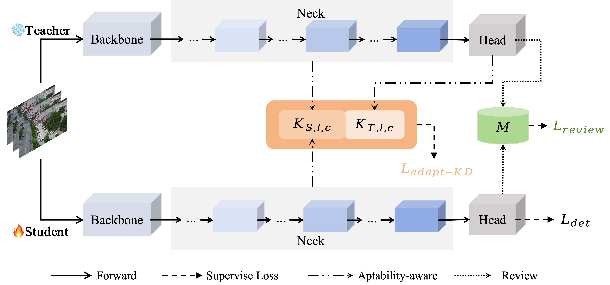

## Liteweight OD

## 💡Introduction

This is our PyTorch implementation of the paper "[`Adaptability-aware and knowledge-review distillation method for UAV Object Detection`]"submitted in ***IEEE Geoscience and Remote Sensing Letters***.


<!-- <div align="center">
    
</div> -->


## 🚩Dataset
```bash
/dataset/VisDrone.yaml:VisDrone2019-DET 
    # https://github.com/VisDrone/VisDrone-Dataset
/dataset/powerdata.yaml: Private Power Data 
    # Due to the signing of a confidentiality agreement, this dataset is not publicly available at this time.
```

## 🛠️Quick Start Examples

<details open>
<summary>Install</summary>

```bash
export WANDB_MODE=disabled
conda activate ObjectDetection #train

# clone the project and configure the environment.
git clone https://github.com/LiuJiaji1999/KDforLiteOD.git
# the version of ultralytics is '8.3.9'           
# GPU - 24G NVIDIA GeForce RTX 3090 
# CPU - 12th Gen Intel(R) Core(TM) i9-12900
pip install -r OD-requirements.txt
attention:
  - opencv-python==4.9.0.80
  - opencv-python-headless==4.9.0.80
  - torch==1.9.0
  - torchvision==0.13.0+cu113
  - torchaudio==0.12.0+cu113
```

</details>

<details open>
<summary>Train</summary>

```shell
## Teacher
python train.py 
# save outputlog
nohup python train.py > /log/XXX.log 2>&1 & tail -f /log/XXX.log
## Student
nohup python distill.py > /home/lenovo/data/liujiaji/powerGit/prune-distill/logs/11mimic-aks-rev_vis.log 2>&1 & tail -f /home/lenovo/data/liujiaji/powerGit/prune-distill/logs/11mimic-aks-rev_vis.log
```
</details>


<details open>
<summary>Test</summary>

```bash
Since github cannot push big file, we put '.pt' into the Google Drive,so you can directly test :
# https://drive.google.com/drive/folders/1SSlZEZvlthQqWaZFEPYCWwkEe-40fqsX
nohup python val.py >> /home/lenovo/data/liujiaji/powerGit/prune-distill/logs/val/11vis-ours.log 2>&1 & tail -f /home/lenovo/data/liujiaji/powerGit/prune-distill/logs/val/11vis-ours.log # test dataset 

python detect.py # Visualization of detect results
```
</details>


#### 📝Detail result
```bash
Because the content exceeds the page limit, we are displaying the category results here:
```

Table: Comparison of different feature distillation methods on VisDrone 2019-DET


Table: Comparison of different feature distillation methods on Private Power Data


#### 🌟Explanation of the file
```bash
1. main_profile.py ：model.info
2. test_yaml.py ：test all yaml is run 
3. heatmap.py ：heatmap
4. get_FPS.py ：compute model param、inference-time、FPS
5. get_model_erf.py ： erf
6. test_other.py ： debug
7. plot_result.py：visualize loss and metrics
```


